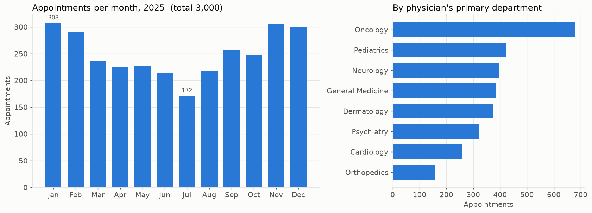
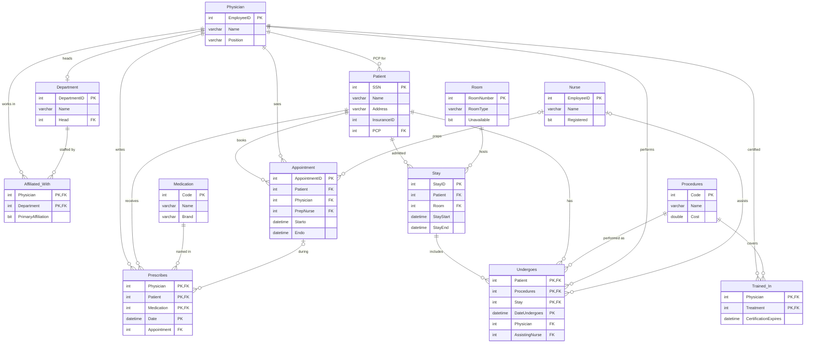
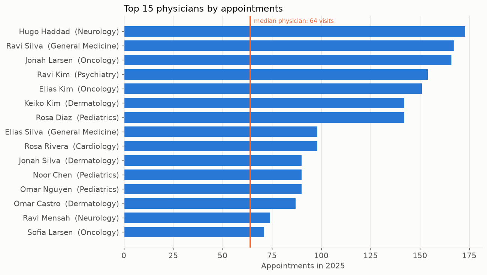
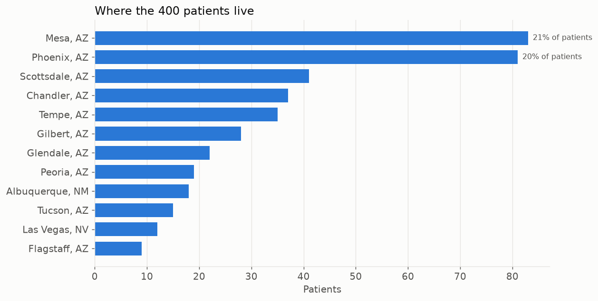

# Hospital operations dashboard

Year Up capstone (December 2025): a MySQL database for an outpatient clinic and a Power BI report
with three views (appointment counts, physician workload, patient geographic distribution).
Rebuilt in 2026 so the SQL can be run and the views inspected without MySQL or Power BI.



## The question

A clinic manager wants to see, at a glance: how busy are we month to month and by department, which
physicians are carrying the load, and where do our patients come from?

## My contribution

Solo. I proposed the project, designed the database (first as a 6-table sketch, then the full
13-table schema below), implemented it in MySQL, wrote the queries behind each dashboard view, and
built the Power BI report on top. The capstone used realistic sample data, not real patients.

## What is in this folder

| Path | Label | What it is |
|---|---|---|
| `original/dump-Hospital-202512151315.sql` | **Original** | `mysqldump` of the `Hospital` database, 2025-12-15. 13 tables with primary and foreign keys. **Schema only, no rows.** No credentials inside. |
| `docs/DATA_DICTIONARY.md` | | Every table and column, with keys and meaning. |
| `docs/QUERY_TO_DASHBOARD.md` | | Which tables, joins and aggregations feed each dashboard view, and why they are written that way. |
| `reconstruction/queries/01..05_*.sql` | **Reconstruction** | The analytical queries behind the three views. The originals were not recovered; these are rebuilt from the schema and the project proposal, written for SQLite with the MySQL equivalents in comments. |
| `improvements/generate_synthetic_data.py` | **Portfolio improvement** | Seeded generator for clearly fake rows (SSNs in the never-issued 900 series, 555-01xx phones, "City, ST" addresses). Stock Python. |
| `improvements/synthetic_data/*.csv` | **Portfolio improvement** | The generated rows: 400 patients, 40 physicians, 3,000 appointments in 2025, and the rest. |
| `improvements/build_sqlite.py` | **Portfolio improvement** | Translates the MySQL dump to SQLite (types only; keys, foreign keys and indexes kept), loads the CSVs with foreign-key checks on, runs all five queries. |
| `improvements/dashboard_views.ipynb` | **Reconstruction** (of the Power BI views, on synthetic data) | The three views as charts, with the SQL that feeds each one. |
| `docs/WALKTHROUGH.md`, `docs/TALKING_POINTS.md` | | Plain-English explanation and interview prep. |

## The schema

Thirteen tables. People and organisation on the left, visits in the middle, inpatient care on the
right. Full column list in `docs/DATA_DICTIONARY.md`.



The planning notes on my Drive show an earlier 6-table version (Department, Physician, Patient,
Medication, Appointment, Prescription). The capstone shipped on the 13-table design above, which
adds nurses, rooms, stays, procedures and certifications so the same database can serve the
inpatient side of a clinic.

## Run it

```bash
# from the repo root, stock Python 3 is enough for these two
python 01-hospital-operations-dashboard/improvements/generate_synthetic_data.py
python 01-hospital-operations-dashboard/improvements/build_sqlite.py      # prints every query's result

# the charts (needs the venv from the root README)
jupyter notebook 01-hospital-operations-dashboard/improvements/dashboard_views.ipynb
```

`build_sqlite.py` writes `hospital.sqlite` next to itself (gitignored). Open it with any SQLite
client and run the files in `reconstruction/queries/` directly.

## Findings

The data is synthetic, so the findings here are about the design, not the clinic.

- **Three views, seven tables.** The dashboard needs only Appointment, Physician, Department,
  Affiliated_With, Patient, Prescribes and Undergoes. The other six exist for the inpatient side and
  stay out of the dashboard's way.
- **Primary affiliation is the key join rule.** A physician can belong to several departments.
  Crediting every appointment to the physician's *primary* department is what makes the department
  totals add up to the overall total instead of over-counting.
- **Side counts need subqueries.** In the workload view, joining prescriptions and procedures onto a
  row set that already has one row per appointment would multiply them. Correlated subqueries keep
  each count honest.
- **Workload is uneven by design and the view shows it.** With the synthetic rows the busiest
  physician sees about 2.7 times the median. That is the kind of gap the view exists to surface.




## One limitation

The Power BI report and the clinic's sample data were lost with the Year Up account, so the charts
here run on generated rows. The shapes are plausible (flu-season peak, summer dip, uneven
workloads, patients clustered in two cities) but they are inputs I chose, not patterns I found.
The schema also uses a patient's SSN as the primary key, a habit inherited from the teaching
design; a production version would use a surrogate patient ID and keep SSN out of the database
entirely.

## How I explain this

"I built the database and the dashboard for an outpatient clinic. The interesting part is the
distance between a normalised schema and a chart: thirteen tables become three views through a few
deliberate join rules, like crediting appointments to a physician's primary department so nothing
is counted twice. The original Power BI file is gone, so I rebuilt the pipeline in a way anyone can
run: synthetic data, SQLite, the same SQL, the same three views in matplotlib." Longer version in
`docs/TALKING_POINTS.md`.

## Recovery note

Being re-downloaded from the Year Up OneDrive: the `.pbix` report (or screenshots of it), the
written capstone report, and any data load script. When they arrive they go in `original/` after a
privacy check, and this README gets the real view screenshots next to the reconstructed ones.
