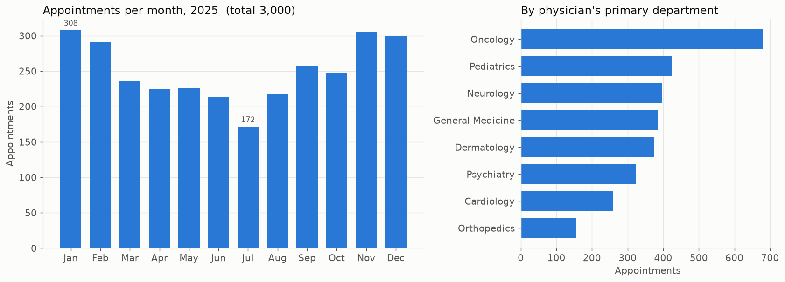
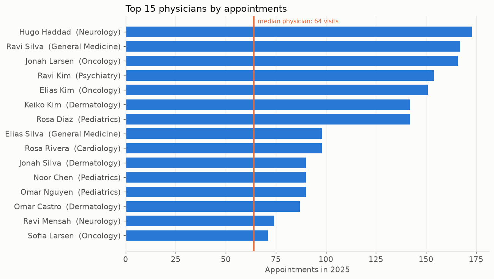
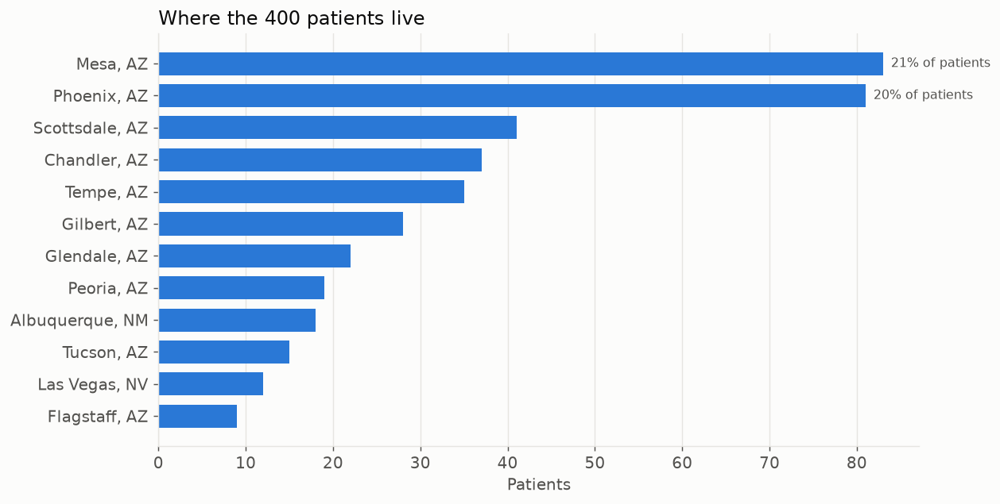

# Walkthrough: from thirteen tables to three charts

## The shape of the database

Think of three groups:

1. **People and organisation.** `Physician`, `Nurse`, `Department`, and `Affiliated_With`, which
   says which physicians work in which departments (and which one is their home department).
2. **Outpatient visits.** `Patient` (with a primary care physician), `Appointment` (patient,
   physician, optional prep nurse, start and end time, room), `Medication` and `Prescribes`.
3. **Inpatient care.** `Room`, `Stay` (a patient in a room between two dates), `Procedures`,
   `Trained_In` (which physician may perform which procedure) and `Undergoes` (a procedure actually
   performed during a stay).

Every arrow in the diagram is a foreign key. The database refuses an appointment for a physician who
does not exist, a stay in a room that does not exist, and so on.

## From a question to a query

Each dashboard view starts as a manager's question and ends as a `GROUP BY`.

**"How busy are we?"** Count rows in `Appointment` by month. Month comes from the first seven
characters of the start timestamp (`2025-03`). Add distinct patients and physicians and the average
visit length for context. To split by department, follow `Appointment.Physician` to
`Affiliated_With`, keep only the row where `PrimaryAffiliation = 1`, then to `Department`.

**"Who is carrying the load?"** Start from `Physician` so nobody disappears, `LEFT JOIN`
appointments, count them and sum their hours. Prescriptions, procedures and panel size come from
three small subqueries, one per physician, so the appointment rows cannot inflate them.

**"Where do patients live?"** `Patient.Address` holds "City, ST". Split it, count patients per city,
add the share of the total and how many appointments those patients generated. A second query
follows each patient's primary care physician to a department, which answers "which department
owns the most patients".

## Reading the charts

Left: appointments per month for 2025, with the busiest and quietest months labelled. Right: the
same appointments credited to the physician's primary department.

Top 15 physicians by appointments, with their department. The orange line is the median across all
40 physicians, so you can see how far the busiest sit above a typical colleague.

Patients by city. The top two cities are labelled with their share. In Power BI this was a map;
here it is bars because the synthetic addresses have no coordinates.

## Why SQLite

The capstone ran on MySQL. Nobody reviewing a portfolio wants to install a database server, so
`build_sqlite.py` reads the MySQL dump, swaps the column types for SQLite ones, keeps every key and
foreign key, and loads the synthetic CSVs with foreign-key checking on. The queries are written to
run on SQLite; wherever a function differs in MySQL, the MySQL line is in a comment beside it.

## What is synthetic and why it is safe

`generate_synthetic_data.py` invents every row with a fixed seed. Names are combinations from two
short lists. Every SSN starts with 900, a block the Social Security Administration never issues.
Phones are 555-01xx, the block reserved for fiction. Addresses are city and state only. The seasonal
pattern (flu-season peak, summer dip) and the uneven physician workloads are chosen inputs so the
charts have something to show; they are not findings.
