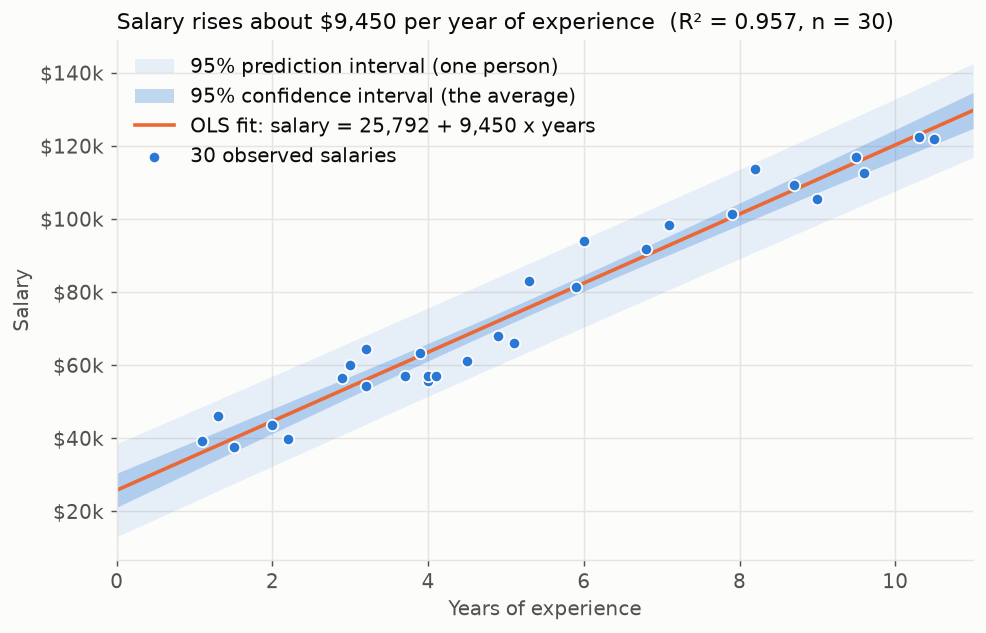
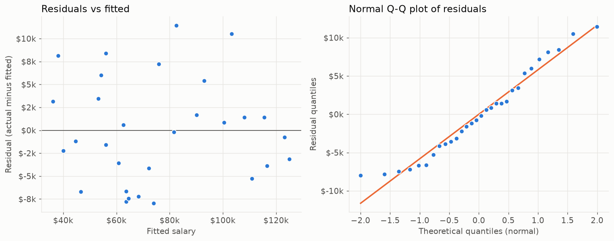

# Salary prediction: how much is a year of experience worth?

Year Up capstone (CIS 304, November 2025), rebuilt and extended in 2026.



## The question

Can years of experience alone predict salary, how strong is the relationship, and how far should
anyone trust the prediction?

## My contribution

Solo project. I chose the dataset, fit an ordinary least squares (OLS) regression in Python with
pandas, statsmodels and matplotlib, interpreted the coefficients and R², built a small interactive
predictor, and presented the results in a 13-slide deck.

## What is in this folder

| Path | Label | What it is |
|---|---|---|
| `original/Salary_Data.csv` | **Original** | The 30-row public Kaggle dataset used in the capstone. See `original/SOURCE.md`. |
| `reconstruction/salary_regression_original.ipynb` | **Reconstruction** | The capstone notebook, rebuilt from the IPython history on my laptop. Same steps, same output: R² 0.957, slope 9,449.96, intercept 25,792.20, matching the slides. Only typos and the data path changed. |
| `improvements/salary_model.py` | **Portfolio improvement** | The model as tested functions: load, fit, predict, intervals, summary, leave-one-out cross-validation. |
| `improvements/tests/test_salary_model.py` | **Portfolio improvement** | 9 pytest checks, including that the coefficients still match the capstone slides. |
| `improvements/salary_analysis.ipynb` | **Portfolio improvement** | The follow-up questions: intervals, residual diagnostics, cross-validation vs a naive baseline, extrapolation. |
| `improvements/predict.py` | **Portfolio improvement** | Command-line version of the capstone's interactive predictor, with a prediction interval and an out-of-range warning. |
| `docs/WALKTHROUGH.md` | | Plain-English explanation of the model, the plots and the numbers. |
| `docs/TALKING_POINTS.md` | | How I explain this project in an interview, with the questions I expect. |

## Run it

```bash
# from the repo root, inside the venv (see the root README)
pytest 03-salary-prediction                                   # 9 tests
python 03-salary-prediction/improvements/predict.py --years 5 --name Abdiel
jupyter notebook 03-salary-prediction                         # both notebooks are pre-executed
```

## Findings

**The line.** Salary ≈ $25,792 + $9,450 × years of experience. Each extra year of experience is
associated with about $9,450 more in salary (standard error $379, p < 0.001).

**The fit.** R² = 0.957: experience alone explains about 96% of the variation in salary in this
dataset. Typical miss (residual standard deviation) is about $5,800.

**Does the straight line hold?** Yes, in this data. Residuals scatter evenly around zero with no
curve or funnel, and the Q-Q plot sits on the line (Shapiro-Wilk p = 0.195).



**On someone new.** Leave-one-out cross-validation, the fair test, gives an RMSE of about $5,900
(7.8% of the average salary). Always guessing the average salary would miss by about $27,900
(36.7%). The line is roughly five times better than the naive baseline.

**Predicting one person.** At 5 years of experience the point estimate is $73,042, but the 95%
prediction interval is $61k to $85k. That band is the honest answer.

## One limitation

Thirty people and one input. Role, industry, location and education all move salary and none of
them are in the data, so the $9,450-per-year slope describes this sample, not the labor market.
The data also stops at 10.5 years; the straight line keeps rising past that point but the
evidence does not. See the last section of `improvements/salary_analysis.ipynb` for the full list.

## How I explain this

"I fit a straight line between years of experience and salary on a small public dataset. The line
says about $9,450 per year, and it explains 96% of the spread. Then I did the things a reviewer
would ask for: error bars on the line and on individual predictions, checks that a straight line is
actually the right shape, a cross-validation score against a dumb baseline, and a clear statement of
where the model stops being trustworthy. The model code is tested, so the numbers on the slides are
verified every time the tests run." Longer version in `docs/TALKING_POINTS.md`.

## Recovery note

The original `.ipynb` and the written report (`CIS 304 Capstone Project Report.docx`) were lost with
the Year Up account. The IPython history on the same machine held every line of the original code,
and the capstone slides (Google Drive) held the reported figures. The reconstruction reproduces
those figures to the cent. If the originals turn up they will be added to `original/`.
