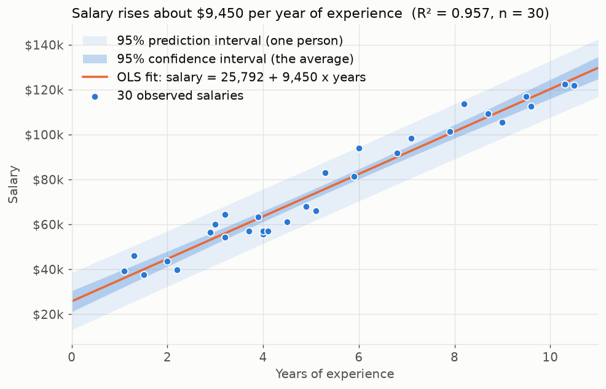
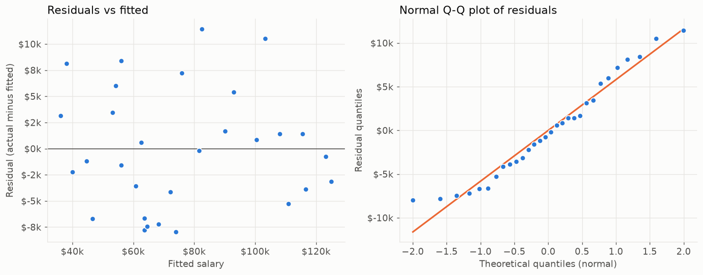

# Walkthrough: the salary model in plain English

## What the model is

A straight line. You give it years of experience, it gives back a salary:

    salary = 25,792 + 9,450 × years

The two numbers come from "ordinary least squares" (OLS): out of every possible straight line, pick
the one where the total of the squared vertical gaps between the dots and the line is smallest.
That is all `statsmodels.OLS(...).fit()` does.

- **25,792 (intercept)** is where the line crosses zero years. Read it as "the line's starting
  point", not as "what a new hire earns": the data has nobody under 1.1 years.
- **9,450 (slope)** is how much the line rises per year. This is the number worth quoting.

## Reading the main chart

- **Dots** are the 30 people in the dataset.
- **Orange line** is the model.
- **Darker band** is the 95% confidence interval. It says where the *average* salary for that level
  of experience probably is. It is narrow because averaging many people pins the line down.
- **Lighter band** is the 95% prediction interval. It says where *one person's* salary probably is.
  It is wide because people vary. If you plug your own experience into the model, this is the band
  you should look at, not the line.

## What R² = 0.957 means, and does not mean

R² is the share of the spread in salary that the line accounts for. 0.957 means that if you know
someone's experience, about 96% of the salary differences between people in this dataset are
"explained"; only 4% is left over.

It does not mean the model is 96% accurate, it does not mean experience *causes* salary, and it
does not promise the same number on new data. It is measured on the same 30 people the line was
fit to, so it is the most flattering score available.

## Checking that a line is the right shape

A residual is actual salary minus the line's prediction. If a straight line is the right shape, the
residuals should look like noise: scattered evenly above and below zero, no curve, no widening.

- **Left:** residuals against fitted values. No curve, no funnel. A straight line is fine here.
- **Right:** Q-Q plot. Sorts the residuals and compares them to what a normal distribution would
  produce. Dots on the line mean the intervals in the main chart can be trusted. A formal test
  (Shapiro-Wilk, p = 0.195) agrees: no evidence the residuals are non-normal.

## The fair accuracy score: leave-one-out cross-validation

Hide one person. Fit the line on the other 29. Predict the hidden person. Record the miss. Repeat
30 times. The root-mean-square of those 30 misses is what you should expect on a new person.

| Approach | Typical miss (RMSE) | As % of average salary |
|---|---|---|
| Always guess the average salary | $27,883 | 36.7% |
| The straight line | $5,924 | 7.8% |

The baseline matters: any model should be compared to the laziest alternative, and this one beats it
by about five times.

## Where the model stops

The data covers 1.1 to 10.5 years. Inside that range the line is backed by dots. Outside it, the
line keeps going but nothing supports it. The extrapolation table in the notebook shows the line
claiming $262k at 25 years; that is arithmetic, not a finding. Real pay growth tends to flatten later
in a career, and this model has never seen that happen.

## What I would do with more data

- Add inputs that are known to move pay (role, industry, location, education) and see how much the
  experience slope changes once they are controlled for.
- Try a curve (log of experience, or a spline) once the data goes beyond ten years.
- Use a much bigger sample. Thirty rows is enough to teach regression, not to describe a market.
